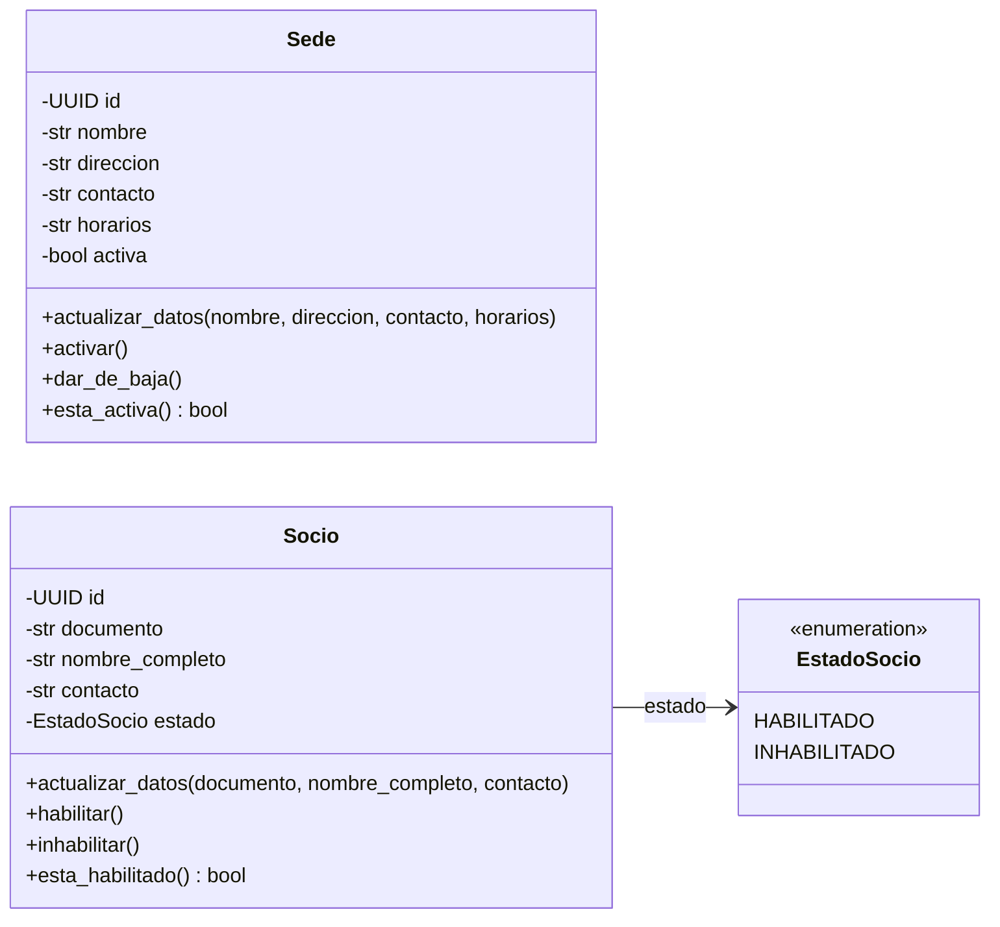
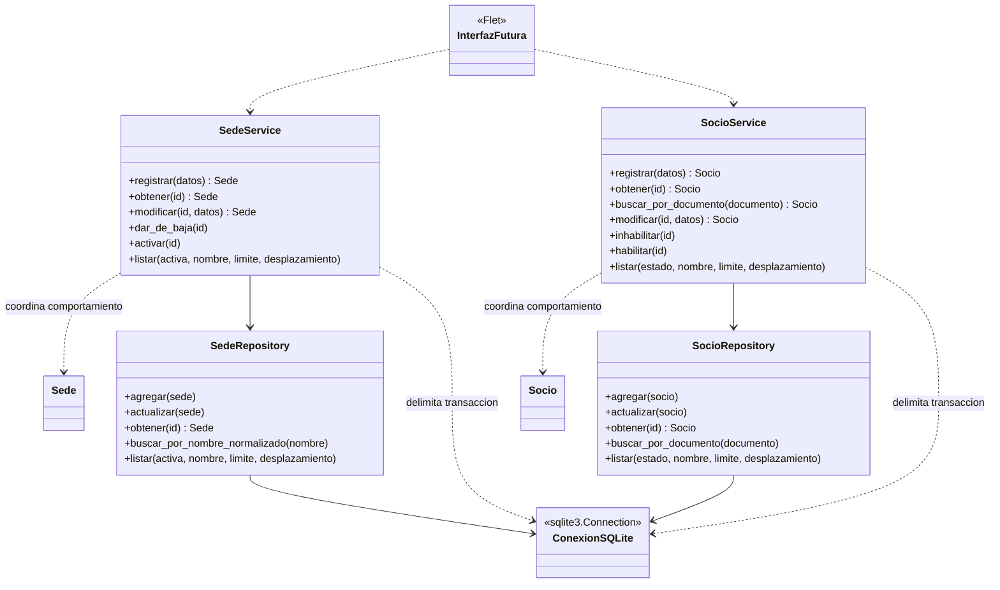
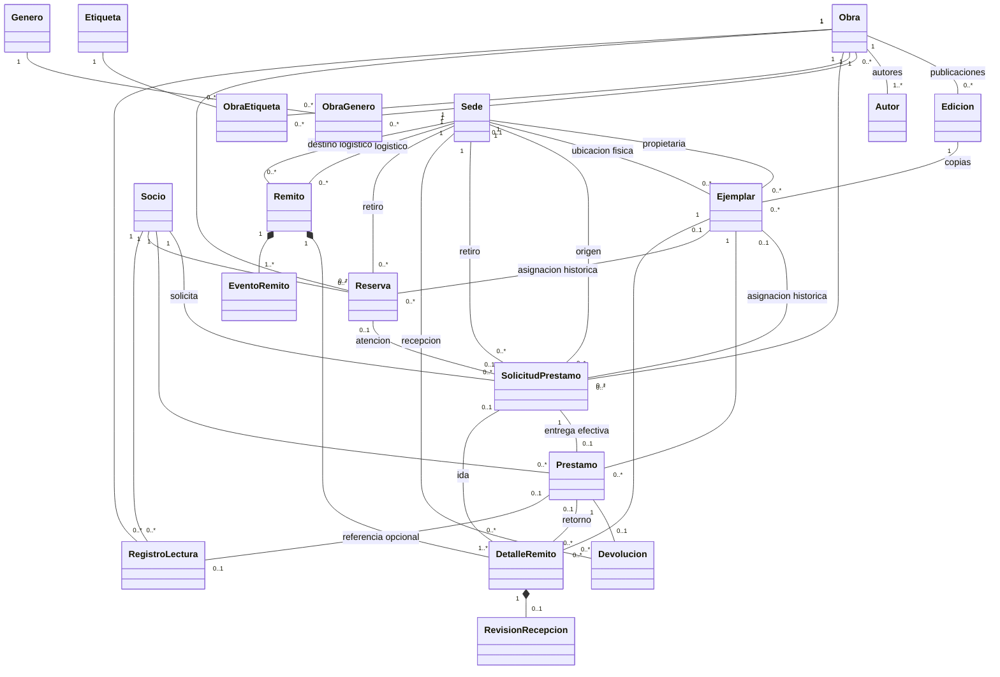
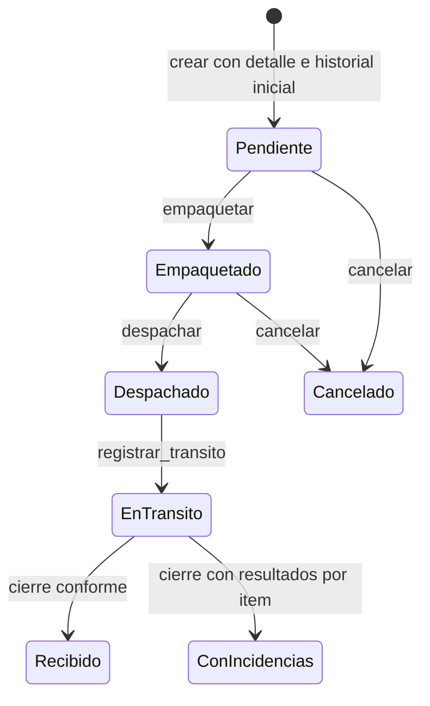
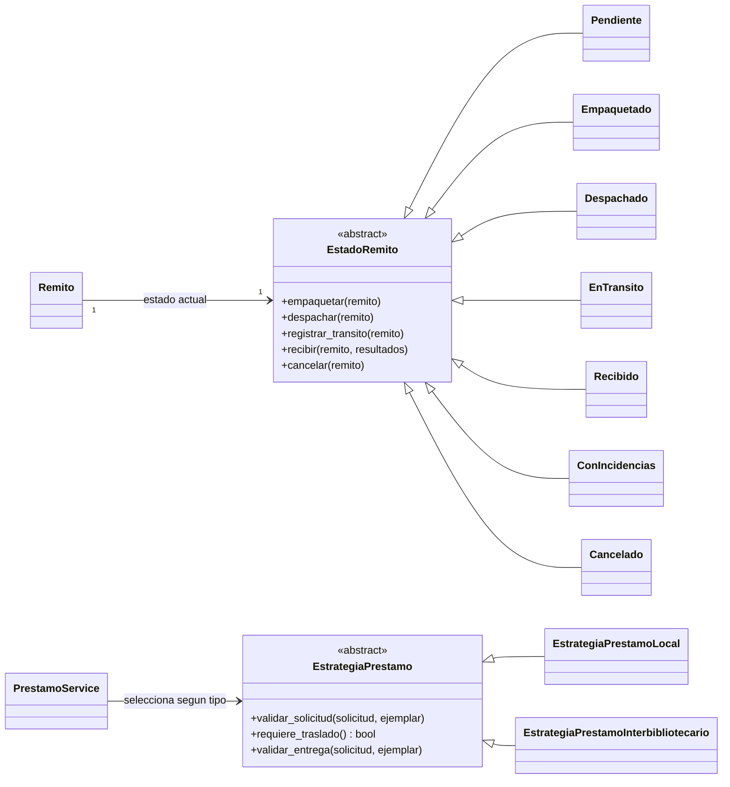

# UML inicial — Etapa 0

Estos diagramas Mermaid expresan el diseño del [análisis de etapa 0](./ETAPA_0_DISENO.md). Se pueden visualizar en un visor compatible con Mermaid. Sedes y socios ya están implementados según este modelo; las relaciones generales y los patrones corresponden a etapas futuras. Los [DOT originales](../archivo/diagramas) se conservan como referencia histórica.

## 1. Dominio del primer módulo

`UUID` es identidad local estable; los atributos se exponen para consulta, pero las modificaciones deben pasar por operaciones que preserven invariantes. Los parámetros agrupados en `datos` representan los campos indicados en cada clase, no una nueva clase obligatoria.

Decisiones del primer módulo: `horarios` se conserva como texto informativo para cubrir la consigna. `documento` representa DNI argentino normalizado y único en toda la red; no hay tipo de documento ni país emisor. Red de Bibliotecas Horizonte es el nombre general de la aplicación; no es atributo de Sede. Norte, Centro y Sur son datos de demostración.

No se agrega asociación Socio–Sede: el registro de socios es de toda la red. Ambas entidades validan datos al construirse y antes de aplicar una modificación completa. Las transiciones simples no requieren clases State.

## 2. Servicios y persistencia del primer módulo

Las dependencias indican uso, no herencia. Los repositorios son clases concretas específicas; no se requiere una jerarquía genérica. La interfaz gráfica se muestra sólo como consumidor futuro.

Las operaciones de escritura delimitan su transacción en el servicio usando una conexión compartida por sus repositorios. El servicio no contiene SQL; el repositorio no confirma transacciones independientemente. Si más adelante un caso necesita varios repositorios, usa la misma conexión. El ensamblado de dependencias se hará en el punto de entrada, sin un framework adicional.

La búsqueda de Socio por documento puede devolver ausencia cuando no hay coincidencia; obtener por ID desde un servicio informa registro no encontrado. Los repositorios devuelven ausencia al obtener un ID inexistente y no hacen inserciones implícitas al actualizarlo.

## 3. Relaciones del dominio completo

Vista de relaciones para orientar los incrementos posteriores; los métodos se detallan al preparar cada módulo. Cada asociación histórica permite muchas operaciones a lo largo del tiempo, pero no varias asignaciones activas incompatibles del mismo ejemplar.

- Obra–Edicion permite cero ediciones en un borrador; la política de catálogo importado publicado exige al menos una edición elegible. La vista muestra obras con autor identificado; registros incompletos del staging no se publican como si cumplieran esta condición.
- ObraGenero y ObraEtiqueta tienen estado de clasificación, procedencia y revisión; no son asociaciones sin atributos.
- Propuesta revisada: el estado de preparación/validación de una edición pertenece a los registros técnicos de importación. Edicion conserva sus datos y validaciones bibliográficas propias; no modela las fases del pipeline como estados de circulación.
- Cada ejemplar conserva una propietaria. La ubicación de sede puede faltar si lo tiene un socio, está en tránsito o no está localizado; su situación operativa conserva el motivo.
- La multiplicidad de solicitudes/reservas por ejemplar es histórica; nunca habilita dos asignaciones activas simultáneas. La reserva atendida y su solicitud deben compartir la misma asignación, no competir por ella.
- Un detalle corresponde a una ida con solicitud o a un retorno con préstamo, no a ambos. Un remito agrupa un único origen, destino y tipo.
- La composición de eventos expresa dependencia de su remito, no autorización para borrar el historial en cascada desde la interfaz.
- La revisión mostrada es la evaluación de recepción inicial; el diseño de recuperación/corrección de incidencias se cerrará antes de etapa 5 sin sobrescribir la evidencia original.

## 4. Ciclo base del remito

Se conserva el [ciclo de referencia](../archivo/diagramas/06_estados_remito.dot). Las transiciones no dibujadas están prohibidas. Cancelación libera sólo las asignaciones que corresponda antes del despacho; no inventa una devolución física.

El instante de despacho marca la salida física; registrar tránsito añade el hito de seguimiento. Recibido y Cancelado cierran ese recorrido; el tratamiento posterior de ConIncidencias se especificará antes de implementar logística. Un remito de retorno es otra instancia que recorre el mismo ciclo, no una transición del remito de ida.

## 5. Aplicación de los patrones

El contrato exacto de Strategy se revisará al implementar circulación: la diferencia es validación/preparación local frente a traslado con recepción, no sólo retornar un indicador. Las reglas comunes no se duplican innecesariamente en las dos variantes. No se agregan estrategias para recomendaciones por el solo hecho de contar patrones.
