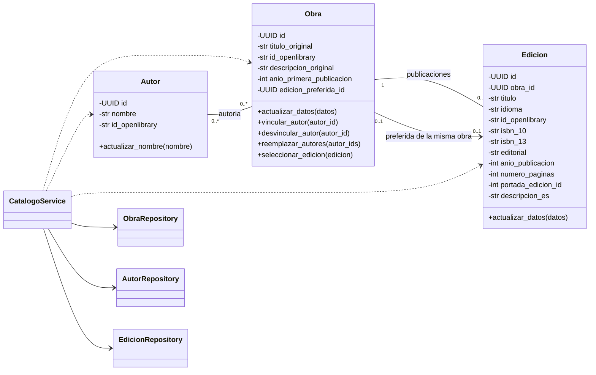
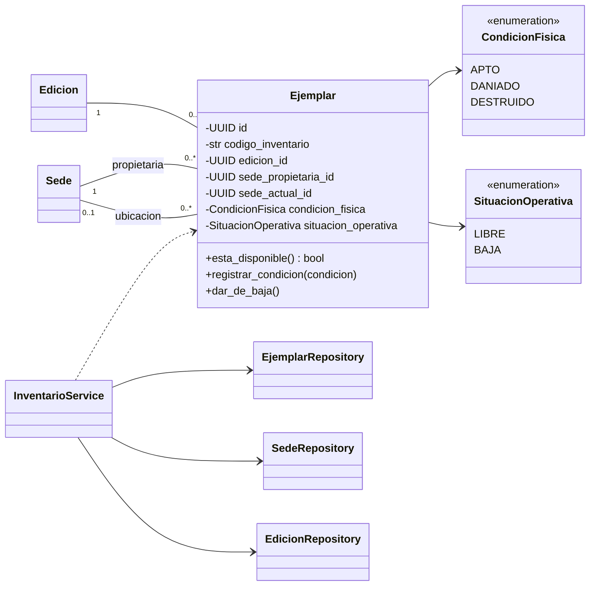
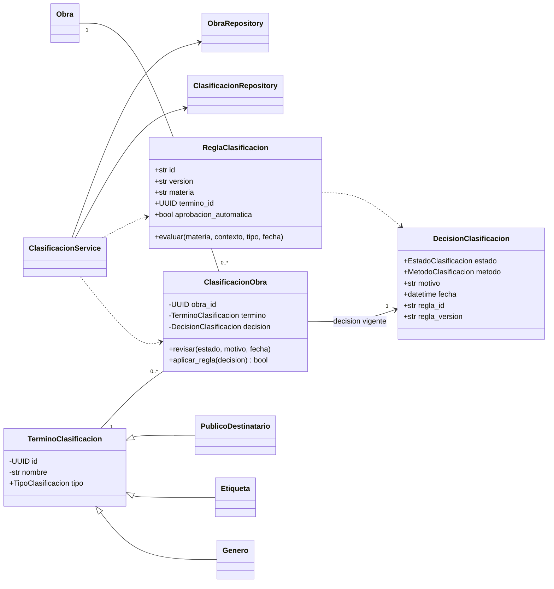
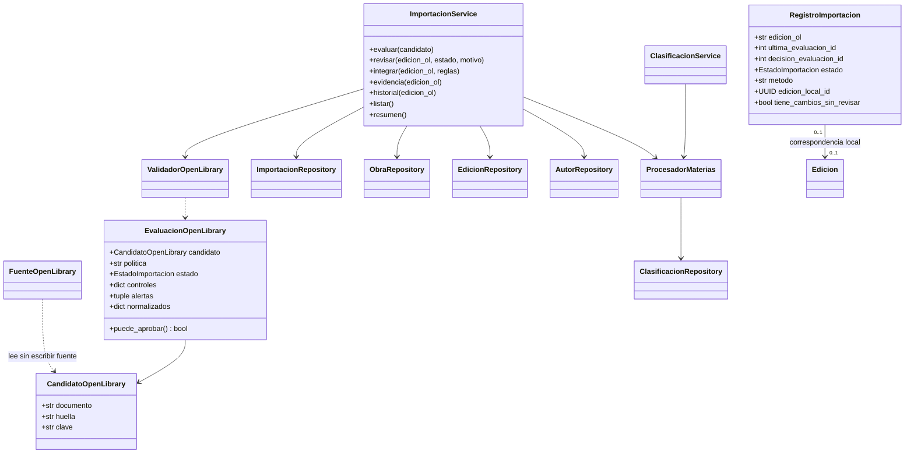
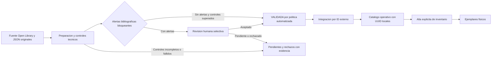

# UML de catálogo e inventario — etapa 2 consolidada y diseño posterior

Complementa el [diseño de etapa 2](./ETAPA_2_DISENO.md). El núcleo 2A, el inventario 2B, la clasificación 2C y la importación 2D ya están implementados y consolidados en 2E; circulación representa etapas futuras. Se omiten parámetros opcionales en los métodos para mantener legible el diagrama.

## Núcleo bibliográfico: incremento 2A

La relación Autor–Obra permite cero durante preparación administrativa. El catálogo utilizable y la exportación importada requieren autor identificado y al menos una edición; el servicio no los publica como completos hasta cumplirlo. No se crea un autor ficticio para llenar el vínculo. El cambio respecto al `1..*` del diagrama general describe ese estado administrativo, no una relajación silenciosa del contrato de exportación.

El ID externo es opcional en las tres clases. Título e idioma son obligatorios en Edicion. Los demás datos bibliográficos opcionales se validan cuando se proporcionan. No hay atributo ni métodos para pasar entre fases de preparación OL en Edicion.

La asociación preferida es un subconjunto de las publicaciones de esa misma obra: el servicio selecciona la primera edición registrada y permite cambiarla. Una clave foránea compuesta respalda esta pertenencia en SQLite. La ficha usa el título de la preferida; buscar incluye el original y **todas** las ediciones españolas. Los listados devuelven FichaObra (una fila por obra) y el detalle devuelve DetalleObra, con metadatos y preferida; las ediciones se consultan por páginas aparte.

El alta conjunta recibe Obra y Edicion nuevas y guarda ambas con sus relaciones en una transacción. No modifica las entidades del llamador; devuelve una lectura de lo persistido. Los IDs OL y la relación Edicion–Obra no se cambian mediante la edición ordinaria de metadatos.

## Copias físicas: incremento 2B

Los estados operativos de asignación, préstamo, traslado y faltantes se incorporarán con circulación. No se ofrece un setter libre para mover ejemplares o cambiar su propietaria. La edición y su inventario no forman una composición que habilite borrar físicamente todas sus copias.

En 2B el alta fija propietaria y ubicación inicial en la sede activa indicada. La ubicación puede ser nula al reconstruir un registro, sin inventar presencia en la propietaria. Código, UUID, edición, propietaria y ubicación se exponen sólo para consulta. El repositorio sólo actualiza condición y situación cuando coincide la identidad/ubicación del registro. Baja es idempotente y cambiar condición no la revierte; DESTRUIDO no vuelve a APTO/DANIADO mediante una corrección ordinaria.

InventarioService recibe los cuatro repositorios de la misma conexión, incluido ObraRepository para verificar que el alta tiene autoría identificada. Sus consultas devuelven DisponibilidadSede con total_propios, total_ubicados, bajas_ubicadas y disponibles, incluyendo sedes sin copias con cero. Estos resultados no equivalen a nuevas entidades de dominio ni a una carga de todas las copias.

La entidad comprueba su disponibilidad propia. El servicio añade la sede activa y la integridad de las relaciones; posteriormente coordinará solicitudes/reservas en la misma transacción. Propiedad estable con retorno sigue siendo la política acordada.

## Clasificación: incremento 2C

El borrador del [UML general](./UML_ETAPA_0.md) anticipaba ObraGenero y ObraEtiqueta. En la implementación se comparte su comportamiento idéntico en ClasificacionObra, manteniendo tres vocabularios concretos. Cada vínculo tiene estado PROPUESTO/APROBADO/RECHAZADO, método, motivo y fecha. APROBADO puede proceder de una decisión humana o de una regla explícita versionada; decisiones humanas previas prevalecen. El público tiene su propio tipo de vínculo, sin convertirse en género o etiqueta temática:

Los términos, decisiones y reglas son valores inmutables validados; la asociación cambia de decisión mediante sus métodos. ClasificacionRepository reconstruye el tipo concreto y persiste cada cambio en un historial separado de las evaluaciones de reglas. Una propuesta manual no resuelta puede aprobarse automáticamente; una aprobación/rechazo manual no se sobrescribe. Si la misma regla encuentra después contexto dudoso, su aprobación automática puede volver a PROPUESTO, conservando ambas evaluaciones y decisiones. Una regla candidata diferente no revoca una aprobación.

SQLite usa termino_clasificacion y clasificacion_obra con tipo y clave foránea compuesta; así no mezcla género/público aunque compartan columnas. Materia original y evidencia conservan texto literal, fuente, contexto, fecha y regla/versionado; la evidencia sólo puede referenciar materias de la misma obra. Regla/versionado no puede redefinirse silenciosamente. Los tres filtros de CatalogoService usan únicamente asociaciones aprobadas y no multiplican las fichas.

Una clasificación es una relación revisable del catálogo; el estado de importación describe un proceso técnico distinto. La cobertura actual se detalla en el [informe de 2C](./ETAPA_2C_RESULTADOS.md).

## Integración Open Library: incremento 2D

Los objetos técnicos de importación no son subclases de Edicion. El repositorio guarda evaluaciones por edición/huella/política, historial de decisiones y seguimiento actual. Las decisiones humanas conservan su evaluación; una nueva fuente queda registrada aparte hasta revisión explícita. La consulta de evidencia permite comparar ambas desde una futura vista. No se cambia el contrato de preparación ni se modifica la fuente.

ProcesadorMaterias extrae el procesamiento compartido de 2C y exige una transacción activa. ClasificacionService conserva su API y delimita su transacción; ImportacionService integra nuevas entidades, materias, clasificaciones y correspondencia en otra transacción única. Ningún repositorio confirma escrituras por su cuenta.

El flujo de metadatos no crea existencias. Reimportar no cambia el UUID local, no reemplaza correcciones humanas y no borra ejemplares. Las bases de preparación se abren como fuente, no se convierten directamente en la base operativa.

La política concreta conserva todos los metadatos/autorías/preferencias existentes al reimportar, incluso si estaban vacíos; completar y corregir son operaciones explícitas del catálogo. Una revisión manual puede aportar títulos corregidos antes de la primera integración. Los posibles duplicados por título/autor o ISBN se señalan; no se fusionan por texto. La edición no puede reasignarse a otra obra. Rechazar una fuente ya incorporada tampoco elimina sus entidades operativas.

Resultado offline de 2D: cinco obras/ediciones integradas, dos candidatas para revisión y 993 pendientes. Ver [diseño](./ETAPA_2D_DISENO.md) y [evidencia de pruebas y ejecución](./ETAPA_2D_RESULTADOS.md).

La aceptación automática registra método, versión, fecha y controles; no equivale a certificación humana de todos los campos. La recepción en otra sede conservará la asignación a la solicitud original: disponibilidad para una nueva solicitud y posibilidad de entrega al socio asignado son comprobaciones distintas. No se modifica libremente la propietaria.

## Consolidación 2E

No se incorporaron nuevas entidades ni patrones. Las interfaces de los servicios y las relaciones anteriores se conservan. Los cambios de SQL se limitan a los repositorios: filtrar/paginar obras antes de contar ediciones, buscar en títulos originales/alternativos conservando unicidad y consultar disponibilidad agregando únicamente copias de la obra. La migración 006 incorpora el índice de ejemplares por sede/estado/código.

La [demostración conjunta](../biblioteca/demo_etapa2.py) compone los servicios existentes y comprueba reapertura/reimportación. La [herramienta de carga](../herramientas/medir_etapa2.py) pertenece a desarrollo: genera bases sintéticas temporales e invoca esos mismos servicios, sin mezclarse con el dominio ni con el importador. Ver [resultados de consolidación](./ETAPA_2E_RESULTADOS.md).
