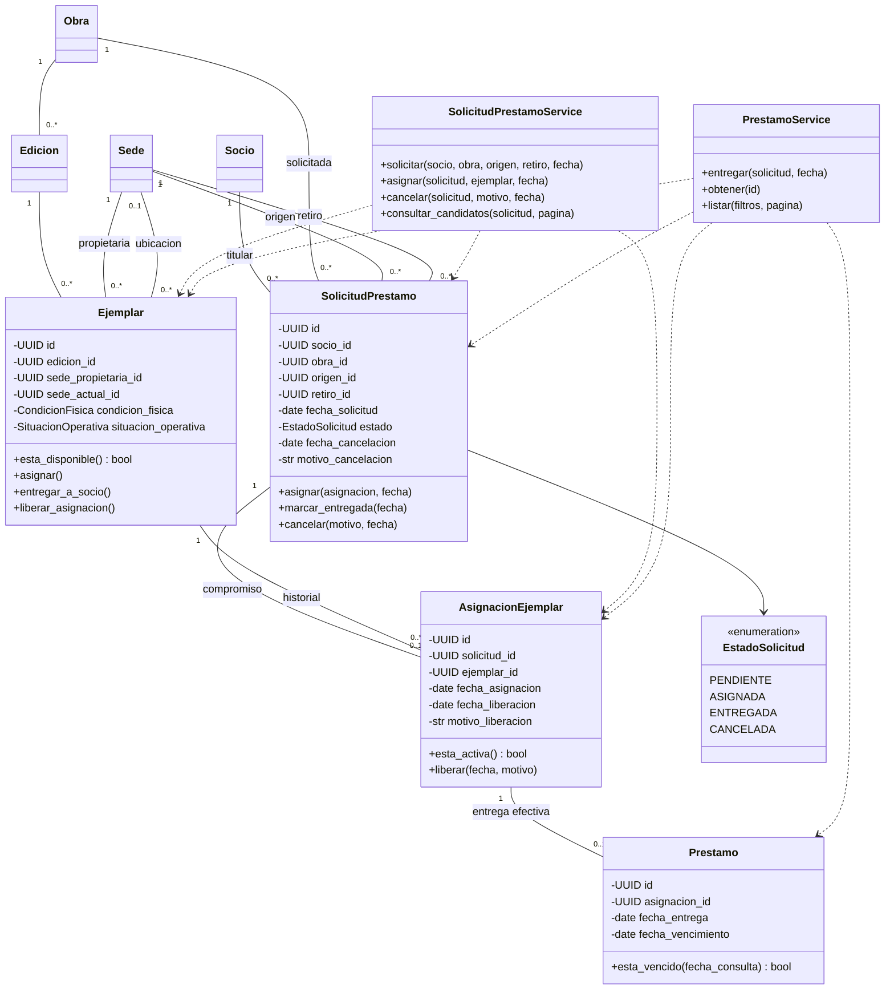
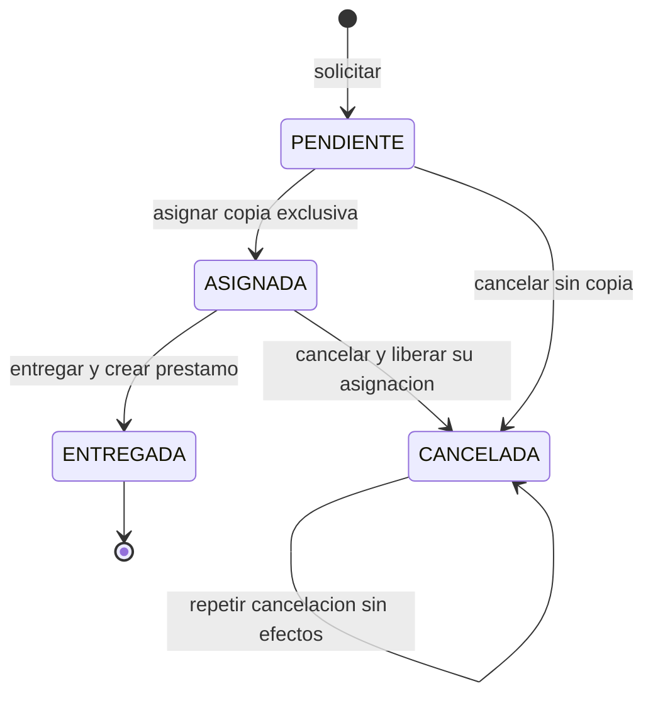
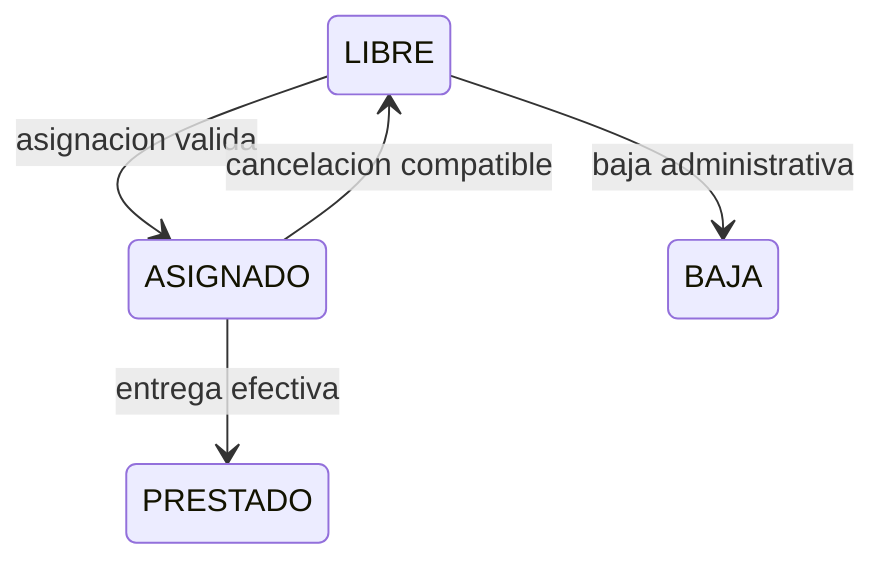
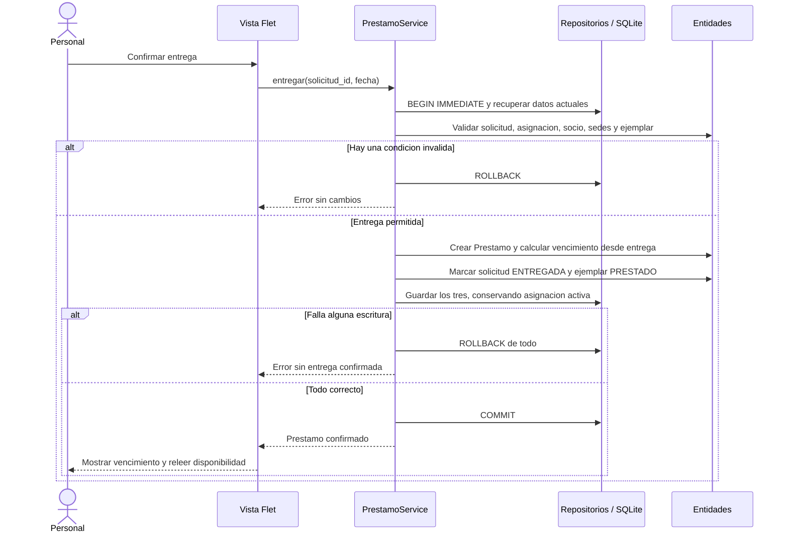
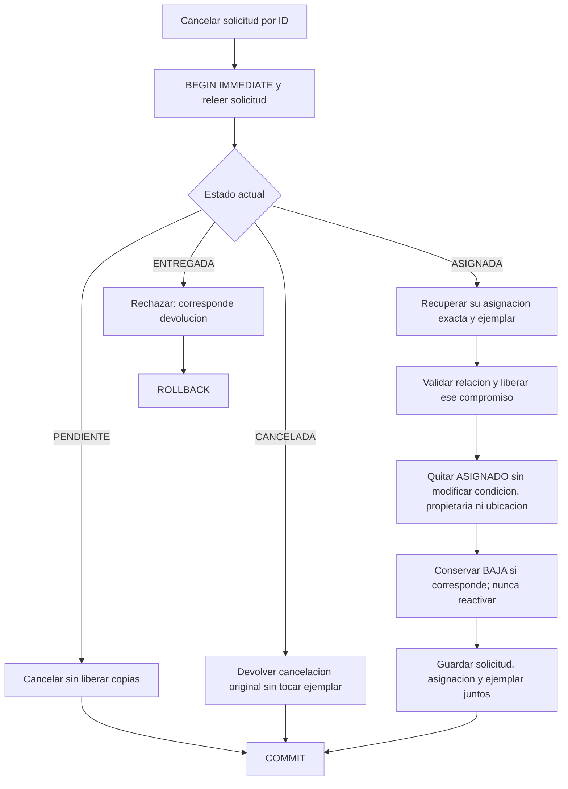

# UML propuesto — Etapa 4, sin implementación

Complementa el [diseño para revisión](./ETAPA_4_DISENO.md). Las clases de circulación y sus métodos son propuestas; Sede, Socio, Obra, Edicion y Ejemplar ya existen, pero los métodos de circulación de Ejemplar aún no. Se omiten atributos bibliográficos para centrar el análisis.

## Clases y relaciones

La cardinalidad histórica Ejemplar–AsignacionEjemplar no permite varias activas: se garantiza una sola asignación no liberada por ejemplar mediante restricción y transacción. Como cada solicitud tiene una asignación como máximo y cada asignación un préstamo como máximo, una solicitud no puede producir dos préstamos. La entrega no libera la asignación.

Fechas opcionales se informan sólo al ocurrir el hecho correspondiente; no se rellenan con fechas ficticias. Los repositorios específicos, omitidos del diagrama para legibilidad, comparten la conexión del servicio y no confirman escrituras por separado.

## Solicitud y situación física

ENTREGADA finaliza la solicitud, no el préstamo. En etapa 4 un préstamo efectivo permanece activo hasta incorporar devolución en etapa 6. Vencido es una consulta por fecha sobre el préstamo abierto, no otro estado de solicitud.

Diagrama limitado a circulación local prevista. Condición física es independiente: LIBRE + DANIADO no significa disponible. Si ya existe una baja, cancelar no la revierte. PRESTADO carece de ubicación de sede; la propietaria permanece. Devoluciones y logística ampliarán este diagrama en sus etapas, sin trasladar propiedad.

## Entrega atómica

## Cancelación sin liberar una asignación ajena

Cualquier fallo de validación/persistencia también revierte todo. Las futuras estrategias local/interbibliotecaria se extraerán al tener comportamientos reales de ambas variantes; por ahora no se agregan clases del patrón al modelo implementado.
